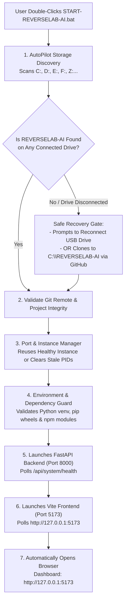

# REVERSELAB AI — AutoPilot & Self-Recovery Guide

## 1. Overview

**REVERSELAB AI AutoPilot** is a self-detecting, self-configuring, and self-recovering launcher system engineered to solve multi-disk and drive-letter variations on Windows.

Instead of manually navigating command lines, setting up virtual environments, or configuring ports, **AutoPilot** manages the entire lifecycle with a single double-click.

---

## 2. Architecture & How AutoPilot Works



---

## 3. Key Capabilities

### 3.1 Dynamic Multi-Drive Discovery
- Enumerates all active Windows drive volumes via `[System.IO.DriveInfo]::GetDrives()`.
- Searches candidate paths on every drive:
  - `anti\REVERSELAB-AI`
  - `REVERSELAB-AI`
  - `Projects\REVERSELAB-AI`
- Verifies identity via Git remote origin: `https://github.com/albykl123/REVERSELAB-AI`.
- **Zero Hardcoded Drive Letters**: Operates identically whether your project is mounted on `C:`, `D:`, `E:`, `F:`, or any other drive letter.

### 3.2 Automated Recovery on Disconnected Drives
- If your 1TB external USB hard drive is unplugged, AutoPilot does not crash.
- It detects the missing drive, outputs an actionable diagnostic message, and offers two paths:
  1. **Reconnect**: Plug in your USB drive and press any key to continue.
  2. **Clone to SSD**: Automatically clones your official GitHub repository (`albykl123/REVERSELAB-AI`) to internal NVMe SSD at `C:\REVERSELAB-AI`.

### 3.3 Port Conflict & Stale Process Handling
- Probes ports `8000` (Backend) and `5173` (Frontend).
- If a healthy REVERSELAB AI instance is already running, it opens your browser immediately without spawning duplicate processes.
- If orphaned node or python processes occupy the ports, it safely terminates only the orphaned REVERSELAB processes.

### 3.4 Dependency Self-Healing
- Automatically detects Python 3.11+ and Node.js 18+.
- Initializes `venv` if missing.
- Installs missing wheels from `requirements.txt` via `pip`.
- Installs missing packages from `package.json` via `npm install`.

---

## 4. File Structure

```text
C:\anti\
├── START-REVERSELAB-AI.bat            <- Main double-click desktop launcher
├── scripts\
│   ├── REVERSELAB-AUTOPILOT.ps1       <- Core storage discovery & recovery engine
│   ├── start_reverselab_ai.ps1        <- PowerShell runner
│   ├── diagnose_reverselab_ai.ps1     <- Comprehensive diagnostic doctor
│   └── stop_reverselab_ai.ps1         <- Clean shutdown script
└── docs\
    └── AUTOPILOT_USER_GUIDE.md        <- This guide
```

---

## 5. Usage Instructions

### Starting REVERSELAB AI:
Double-click `START-REVERSELAB-AI.bat` in `C:\anti\` (or on your desktop).

### Stopping REVERSELAB AI:
Run `powershell -ExecutionPolicy Bypass -File C:\anti\scripts\stop_reverselab_ai.ps1` or press `Ctrl + C` in the launcher console.

### Running Diagnostics:
Run `powershell -ExecutionPolicy Bypass -File C:\anti\scripts\diagnose_reverselab_ai.ps1` to view connected drives, Python/Node versions, and port statuses.
